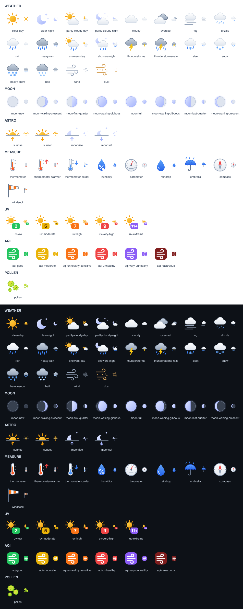

# Weatheo Icons

Original animated and static SVG weather icons, 53 of them, MIT licensed.



Live catalogue: https://weatheo.com/en/icons

## Usage

Every icon comes in two variants: `svg/animated/` (CSS animation inside the SVG) and `svg/static/`.

### a) `` from jsDelivr

```html


```

### b) npm

npm package: coming soon.

```sh
npm i weatheo-icons
```

Then use the files from the package, for example `weatheo-icons/svg/animated/rain.svg` (with your bundler's asset import or by copying them to your public folder).

### c) Inline SVG

Paste the file contents straight into your HTML. Every id, class and keyframe name is prefixed with the icon name (`wtc-<name>-`), so many icons can be inlined on the same page without clashes.

## Use with the Weatheo API

```
GET https://weatheo.com/api/v1/weather?place=fr/centre-val-de-loire/gien
```

The response holds `current.condition.icon`, an OpenWeather-style code such as `"04d"`. Each code has its own copy: `svg/animated/owm/04d.svg` (and `svg/static/owm/04d.svg`).

For a finer mapping, `icons.json` lists for every icon its `name`, `title`, `category`, `tags`, `owm` codes and `owmIds` (OpenWeather condition ids, e.g. `502` heavy rain, `602` heavy snow).

## Icons

| Category | Icons |
|---|---|
| Weather (20) | `clear-day`, `clear-night`, `partly-cloudy-day`, `partly-cloudy-night`, `cloudy`, `overcast`, `fog`, `drizzle`, `rain`, `heavy-rain`, `showers-day`, `showers-night`, `thunderstorms`, `thunderstorms-rain`, `sleet`, `snow`, `heavy-snow`, `hail`, `wind`, `dust` |
| Moon phases (8) | `moon-new`, `moon-waxing-crescent`, `moon-first-quarter`, `moon-waxing-gibbous`, `moon-full`, `moon-waning-gibbous`, `moon-last-quarter`, `moon-waning-crescent` |
| Sun and moon (4) | `sunrise`, `sunset`, `moonrise`, `moonset` |
| Measures (9) | `thermometer`, `thermometer-warmer`, `thermometer-colder`, `humidity`, `barometer`, `raindrop`, `umbrella`, `compass`, `windsock` |
| UV index (5) | `uv-low`, `uv-moderate`, `uv-high`, `uv-very-high`, `uv-extreme` |
| Air quality (US EPA AQI) (6) | `aqi-good`, `aqi-moderate`, `aqi-unhealthy-sensitive`, `aqi-unhealthy`, `aqi-very-unhealthy`, `aqi-hazardous` |
| Pollen (1) | `pollen` |

## Accessibility

Every SVG has `role="img"` and a `<title>`, so screen readers announce it when inlined; with ``, give it an `alt`. The animated variant stops all animation under `prefers-reduced-motion: reduce`.

## Build

`node scripts/build.mjs` regenerates `svg/`, `icons.json` and `docs/sheet.png` (needs `rsvg-convert`); `node scripts/build.mjs --check` validates sizes, ids and markup.

## License

MIT, see [LICENSE](LICENSE).

Made by Weatheo — [weatheo.com](https://weatheo.com), free weather forecasts for every town.
